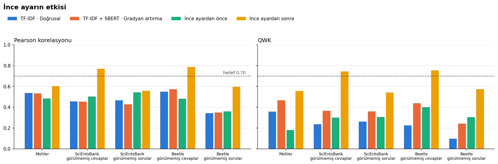

# CevapAnaliz

Açık uçlu öğrenci cevaplarını, öğretmenin referans cevabıyla **anlam bakımından** karşılaştırarak otomatik puanlayan, puanın nedenini (eksik kavramları) gösteren ve emin olamadığı cevapları öğretmenin kontrolüne bırakan bir değerlendirme sistemi.

Fırat Üniversitesi Bilgisayar Mühendisliği Tasarım Dersi projesi · **Semantik Mühendisleri**


## Klasör yapısı

```
notebooks/          Deneyler: Türkçe açıklamalı Google Colab not defterleri (01–05)
data/raw/           Ham veri setleri (depoya yüklenmez, betikle indirilir)
data/processed/     Ortak biçime çevrilmiş veri (depoya yüklenmez)
scripts/            Çalıştırılabilir betikler (veri indirme, dönüştürme, ilk deney)
src/veri/           Veri setlerini ortak biçime çeviren kod
src/puanlama/       Puanlama motoru: özellikler (FR-03) ve başarı ölçütleri (NFR-01)
src/arayuz/         Web arayüzü (Streamlit) — geliştirilecek
tests/              Birim testleri
sonuclar/           Deney sonuçları (CSV) ve grafikler (sonuclar/sekiller)
```

## Deneyler

Deneyler Google Colab'da çalıştırılır; veriler, sonuçlar ve grafikler Google Drive'daki `CevapAnaliz` klasöründe saklanır. Her not defteri, her adımın ne yaptığını ve neden yapıldığını Türkçe açıklar.

| Not defteri | Konu | GPU |
|---|---|---|
| [01 – Veri İnceleme](notebooks/01_veri_inceleme.ipynb) | Veri setlerinin içeriği, puan dağılımı, cevap uzunlukları, kelime örtüşmesi | Gerekmez |
| [02 – Ön İşleme ve TF-IDF](notebooks/02_on_isleme_tfidf.ipynb) | Beş ön işleme seçeneği, TF-IDF'in çalışması, doğrusal regresyon | Gerekmez |
| [03 – Sentence-BERT](notebooks/03_sentence_bert.ipynb) | Hazır cümle gömme modelleriyle (MiniLM, MPNet) anlam benzerliği | Önerilir |
| [04 – Özellik Birleştirme](notebooks/04_ozellik_birlestirme.ipynb) | TF-IDF ve Sentence-BERT özelliklerinin doğrusal regresyon ve gradyan artırmayla birleştirilmesi | Gerekmez |
| [05 – İnce Ayar](notebooks/05_ince_ayar.ipynb) | Çapraz kodlayıcının (DistilRoBERTa) öğretmen puanlarıyla eğitilmesi | **Gerekir** |

**Colab'da çalıştırma:**
1. Google Drive'da `CevapAnaliz` adında bir klasör aç ve not defterlerini içine yükle.
2. Not defterine çift tıklayıp Colab'da aç; **Çalışma zamanı → Tümünü çalıştır** de ve Drive erişimine izin ver.
3. Not defterleri sırayla çalıştırılmalıdır (03, 04 ve 05 öncekilerin sonuçlarını kullanır).

> Colab'da Mohler veri setinin indirilmesi, kaynak sunucunun sertifika yapılandırması nedeniyle SSL hatası verebilir. Bu durumda `data/raw` klasörünü kendi bilgisayarında `python scripts/veri_indir.py` ile indirip Drive'daki `CevapAnaliz/data/raw` konumuna elle yükle.

## Sonuçlar

Her hücrede **Pearson / QWK** değeri yer alır. Hedef (NFR-01): ikisi de ≥ 0,70. Kalın değerler hedefi geçenlerdir.

| Yöntem | Mohler | SciEntsBank görülmemiş cevaplar | SciEntsBank görülmemiş sorular | Beetle görülmemiş cevaplar | Beetle görülmemiş sorular |
|---|---|---|---|---|---|
| Kelime tabanlı (TF-IDF, kök bulma) | 0,54 / 0,36 | 0,46 / 0,24 | 0,47 / 0,26 | 0,55 / 0,23 | 0,34 / 0,10 |
| Anlam tabanlı (Sentence-BERT MiniLM) | 0,49 / 0,35 | 0,40 / 0,23 | 0,44 / 0,26 | 0,49 / 0,34 | 0,23 / 0,17 |
| Özellik birleştirme (gradyan artırma) | 0,53 / 0,47 | 0,45 / 0,37 | 0,43 / 0,36 | 0,57 / 0,44 | 0,35 / 0,24 |
| **İnce ayarlı çapraz kodlayıcı** | 0,60 / 0,56 | **0,77 / 0,74** | 0,56 / 0,54 | **0,79 / 0,76** | 0,60 / 0,57 |

- Mohler'de soru bazlı 5 katlı çapraz doğrulama, SciEntsBank ve Beetle'da veri setlerinin kendi test kümeleri kullanılmıştır.
- İnce ayarlı model, eğitimde görülen sorulara verilen yeni cevaplarda hedefi aşmıştır; eğitimde hiç görülmemiş sorularda hedefin altında kalmaktadır.
- Ayrıntılı sonuçlar `sonuclar/` klasöründeki CSV dosyalarında, grafikler `sonuclar/sekiller/` klasöründedir.



## Yerel kurulum

Python 3.10 veya üzeri gerekir.

```bash
python -m venv .venv
.venv\Scripts\activate          # Windows
# source .venv/bin/activate     # macOS / Linux
pip install -r requirements.txt
```

```bash
python scripts/veri_indir.py     # Mohler ve SemEval-2013 veri setlerini data/raw/ altına indirir
python scripts/ortak_bicim.py    # Hepsini data/processed/ortak_veri.csv dosyasında birleştirir
python scripts/ilk_deney_tfidf.py  # TF-IDF ile ilk deney (sonuclar/ilk_deney_tfidf.csv)
python -m pytest                 # Birim testleri
```

| Veri seti | Cevap | Soru | Puan / etiket | 0–1 puana çevirme |
|---|---|---|---|---|
| Mohler (UNT) | 2.273 | 81 | 0–5 (iki puanlayıcının ortalaması) | puan / 5 |
| SemEval-2013 SciEntsBank | 10.804 | 195 | 5 etiket | doğru = 1, kısmen doğru = 0,5, diğerleri = 0 |
| SemEval-2013 Beetle | 5.199 | 42 | 5 etiket | aynı |

Ortak biçimin sütunları: `veri_seti, bolum, soru_id, soru, referans_cevap, ogrenci_cevap, orijinal_puan, puan`

Veri dosyaları lisans koşulları nedeniyle depoya eklenmez; herkes yukarıdaki betikle kendi bilgisayarına indirir.

## Lisans

MIT
